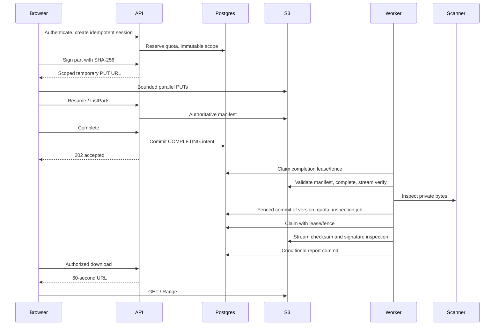

# Architecture and implementation assessment

Option C is the intended architecture. Proxying bytes through Spring doubles the app network path and adds connection pressure; direct signed multipart requests let storage absorb data throughput. A regional/global design adds routing, replication, sovereignty, and conflict resolution costs and remains a future extension.

The current implementation is a modular service, not separate microservices. PostgreSQL owns sessions, namespaces, immutable versions, reservations, sharing, changes and jobs. Redis is optional acceleration. Kafka/outbox is not implemented; durable PostgreSQL polling avoids a database/message dual write for the current local pipeline.

## Protocol contract

Part size is max(8 MiB, ceil(size / 10000)); one-based part numbers, 10,000 maximum. Browser concurrency is three, retry budget four with exponential delay and jitter. One file transfers at a time. Pause aborts client requests; in-flight uncertain results are reconciled using ListParts. The user must reselect identical bytes after restart; SHA-256 and size must match. Browser storage holds an upload ID only and never proves uploaded progress.

Each signed PUT includes a base64 SHA-256, enforced by the provider. Completion checks the provider's part numbers, sizes and SHA-256 values against durable authorized part checksums. Server reads the resulting object with a 128 KiB buffer and checks whole-object SHA-256 and length. Multipart ETags are not whole-file hashes. Keys are private, random, and never reused for different content. This deployment uses immutable keys rather than provider version IDs; credentials with overwrite authority remain an operational risk.

Session states: INITIATED → UPLOADING → COMPLETING → COMPLETED; ABORTED and QUARANTINED are terminal. Completion requests durably mark intent under a short namespace lock and return HTTP 202. The worker atomically claims a 60-second lease with a monotonically increasing fence; a dedicated heartbeat renews every 15 seconds. Multipart completion, streamed SHA-256 verification, and mandatory scanning happen outside database transactions. The final short transaction checks state, unexpired lease, fence, scope, visibility and expected revision before publishing a version and committing quota. Failed workers are reclaimed after expiry; retry backoff is bounded. Eight attempts or a permanent integrity/authorization error moves the session to private review quarantine, with reservations transferred to forensic accounting. Reconciliation remains a secondary recovery path.

Downloads pin an explicit immutable file-version ID, size, whole-file SHA-256 and strong storage ETag. Managed Chromium downloads fetch up to three parallel 8 MiB ranges and write ordered batches to a File System Access destination. Each durable IndexedDB checkpoint follows a committed batch of up to 24 MiB. Resume requests fresh authorized credentials for the same version, sends If-Range, and checks 206, exact Content-Range, ETag and response length before committing a range. A final streamed read from disk verifies whole-file SHA-256. Failed or uncertain ranges repeat from the last committed checkpoint. Responses may finish out of order, but a batch commits in byte order only after every response passes validation. The dedicated OPFS worker uses synchronous bounded writes and flushes before its checkpoint; this avoids repeated prefix copies. File System Access destinations may still incur browser-specific copy costs. A real 20 GB OPFS restart/download/checksum run is recorded separately. Browsers without File System Access fall back to native streaming downloads without application-managed verification or resume guarantees. Signed URLs expire after 60 seconds; revocation cannot invalidate an already issued URL before expiry. No CDN deployment is configured.

Supplemental processors support PNG thumbnails (32 MiB source cap, 16 million source pixels, subsampled decode), UTF-8 document metadata and bounded ZIP inventory (1,000 entries and 64 MiB expanded bytes). They do not execute subprocesses, macros or scripts. Outputs are attempt-specific objects with fenced artifact registration, SHA-256 and processor version. Artifact APIs require an authorized current version and a successful processing job. Outputs created before a worker crash are registered with the garbage collector before PUT. Old-version output is not returned through current-artifact APIs. These in-process processors still require a dedicated sandbox deployment before use with adversarial enterprise workloads.

## Capacity model

100,000 active sessions × 3 parts = 300,000 possible storage connections, not application connections. At 20 Mbit/s per session aggregate ingress is 2 Tbit/s (250 GB/s); 20 GB per file implies roughly 800 seconds, ignoring overhead. At 8 MiB parts, 20 GiB uses 2,560 parts; 100,000 such sessions imply 256 million part rows. Per-namespace locks limit hot-tenant throughput. The requested p99 and concurrency targets are unmeasured. Cost = stored GB-month × regional rate + PUT/GET/list requests × request rate + network GB × egress rate + processing core-hours × rate. No fixed cloud prices are asserted.

## AWS Well-Architected review

| Pillar | Current evidence | Remaining production risk |
|---|---|---|
| Operational excellence | Compose, Kubernetes manifests, metrics, tests | Release gates, rollback drills, runbooks need operational validation |
| Security | OIDC validation, tenant checks, scoped URLs, quarantine, ClamAV and local restricted PDF/video broker | Browser OIDC UX, production parser isolation, scanner size and throughput limits |
| Reliability | Durable sessions, idempotency, leases, fencing, reconciliation | Multi-AZ failover, restore and crash recovery need testing |
| Performance efficiency | Direct storage, bounded buffers/workers | Measured 20 GB MinIO and Chromium OPFS flows; native external-destination copy costs and production-scale concurrency remain unmeasured |
| Cost optimization | Resume, cleanup, immutable references | Actual regional costs and workload measurements missing |
| Sustainability | Retry individual parts, bounded verification memory | Duplicate full reads; deduplication and artifact optimization missing |

The asynchronous media inspector is supplementary: mandatory integrity and scan gates run in the leased completion worker. Inspector failure does not revoke an existing version. It is a bounded supplementary pipeline, not unrestricted media conversion. The configured local broker provides PDF first-page and MP4 preview/full short-video transcoding. Headers alone never establish parser safety.

## PDF/video sandbox and measured transfer continuation

PDF first-page previews and MP4 first-frame previews use an authenticated loopback broker and fresh non-root Docker containers. Parsers have no network, a read-only root, no capabilities, CPU/memory/PID bounds, bounded tmpfs scratch/output and a hard timeout. Only a read-only source file is mounted. The Docker control plane is available to the trusted broker, never to the backend or the parser. This local isolation reference is not a deployed multi-tenant Kubernetes sandbox; PNG/text/ZIP processors remain in-process under existing budgets.

Server object reads now use 16 MiB ranges with If-Match against the HEAD ETag, strict 206/content-range/length checks, and an incremental whole-file digest. This preserves complete cryptographic verification without a whole-object heap allocation. Actual 20 GB MinIO upload/verification/download succeeded; see [measured results](MEASURED-RESULTS.md). The scanner-enabled policy still rejects 20 GB with 413. The large-file run explicitly disabled scanning and must not be used as a production security claim.

## Management and processing continuation

Namespace/file ownership is validated centrally before namespace-owner privileges apply. This prevents a caller from creating sharing grants against a file ID from another namespace. Admin operations require a trusted tenant administrator role and constrain every query to that tenant. Quota edits are compare-and-set operations and cannot undercut committed, reserved and quarantined usage. Upload admission uses a durable per-namespace minute window under the namespace transaction; existing idempotency receipts bypass new admission charging.

Manual reconciliation is a durable leased request, deduplicated while active for a tenant. It calls the same recovery engine, retains its fence and bounds retries. Processing attempt history uses `(job, fence)` identity. An artifact is exposed only when its recorded fence equals the successful job's current fence and its source is the authorized current version. Reprocessing resets the unique source job, advances its fence and retains attempt history. In-flight/expired attempt history is still incomplete for some hard-crash cases.

The local broker's full video transcode admits at most 64 MiB and 120 seconds, checks finite duration, bounds all parser commands and output, validates duration and decodes the resulting MP4. It uses fixed argument lists/paths and no content-derived command execution. Each request receives a non-root, no-network, read-only Docker container with 1 CPU, 512 MiB and bounded temporary storage. These local constraints need a production isolation design; large video transcoding is not supported.

The authenticated OpenAPI endpoint derives registered routes and request schemas from Spring mappings. Its response schemas remain generic. PostgreSQL polling is the durable work transport; Kafka/outbox/inbox is an unimplemented extension. See the current implementation matrix for acceptance gaps rather than treating reference infrastructure as deployed evidence.
